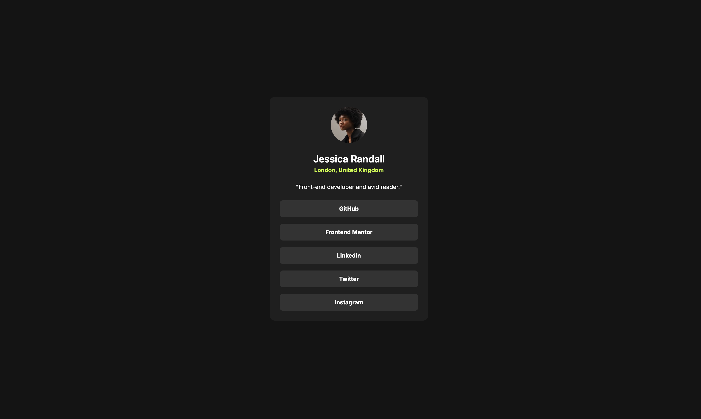

# Frontend Mentor - Social links profile solution

This is a solution to the [Social links profile challenge on Frontend Mentor](https://www.frontendmentor.io/challenges/social-links-profile-UG32l9m6dQ). Frontend Mentor challenges help you improve your coding skills by building realistic projects. 

## Table of contents

- [Overview](#overview)
  - [The challenge](#the-challenge)
  - [Screenshot](#screenshot)
  - [Links](#links)
- [My process](#my-process)
  - [Built with](#built-with)
  - [What I learned](#what-i-learned)
  - [Continued development](#continued-development)
  - [Useful resources](#useful-resources)
  - [AI Collaboration](#ai-collaboration)
- [Author](#author)

## Overview

### The challenge

Users should be able to:

- See hover and focus states for all interactive elements on the page

### Screenshot



### Links

- Solution URL: [Add solution URL here](https://your-solution-url.com)
- Live Site URL: [Add live site URL here](https://your-live-site-url.com)

## My process

### Built with

- Semantic HTML5 markup
- CSS custom properties
- Flexbox
- Mobile-first workflow

### What I learned

For this project, I've encountered some little difficulties with making the whole pills clickable and focusable. I learned that when I use pseudo-classes, it's the same as if I'm inside that tag. 

I discovered that instead of using :focus-visible like:
```css
.link:hover, .link:focus-visible {
    .link {
        background-color: var(--green);
    }
    a {
        color: var(--grey-700);
    }
}
```
I can use it with :focus-within and make everything within the pill clickable and focusable with:
```css
.link:hover, .link:focus-within {
    background-color: var(--green);
    color: var(--grey-700);
}
```
In this process I put the class names inside the anchor tag and make it fill the whole available width

### Continued development

For this dificulty level, I'm very good with what I've learned so far. I'm just hoping to develop a keen eye to match mook designs perfectly.

### Useful resources

- [Media Queries](https://developer.mozilla.org/en-US/docs/Web/CSS/Guides/Media_queries/Using) - This helped me for understanding media queries principles
- [Focus Within Pseudo-Class](https://developer.mozilla.org/en-US/docs/Web/CSS/Reference/Selectors/:focus-within) - This documentation was useful for understanding the way to focus with the Tab key on the whole pill

### AI Collaboration

I've used AI to evaluate comparisons between my work and the jpg files. I've also tried to ask it questions about how to make the pills clickable and hoverable. It is a bit of a shame that it doesn't really compare the pixels. Other than that, it's great tool for learning.

## Author

- Website - [Alex Ionita](https://github.com/Alexandru736/social-links-profile)
- Frontend Mentor - [@Alexandru736](https://www.frontendmentor.io/profile/Alexandru736)